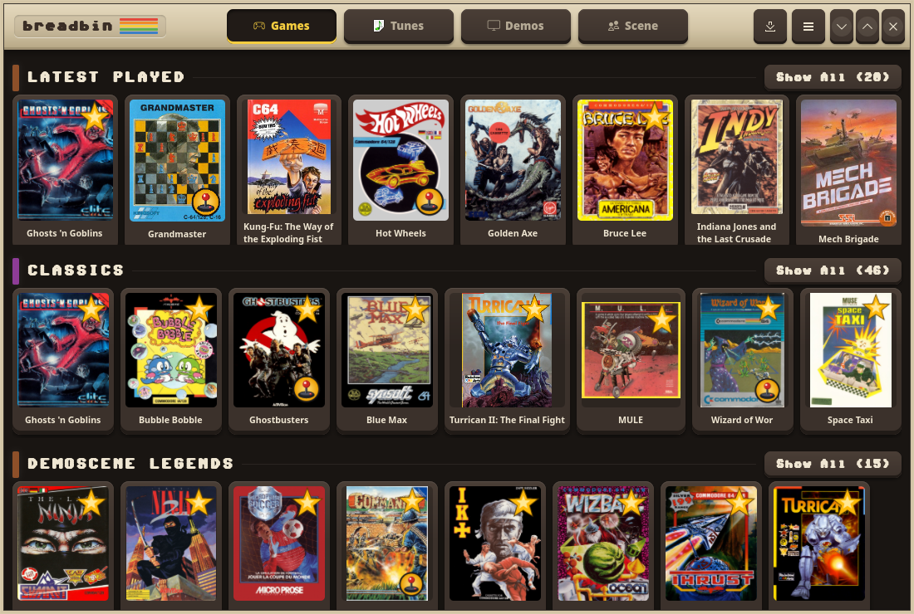
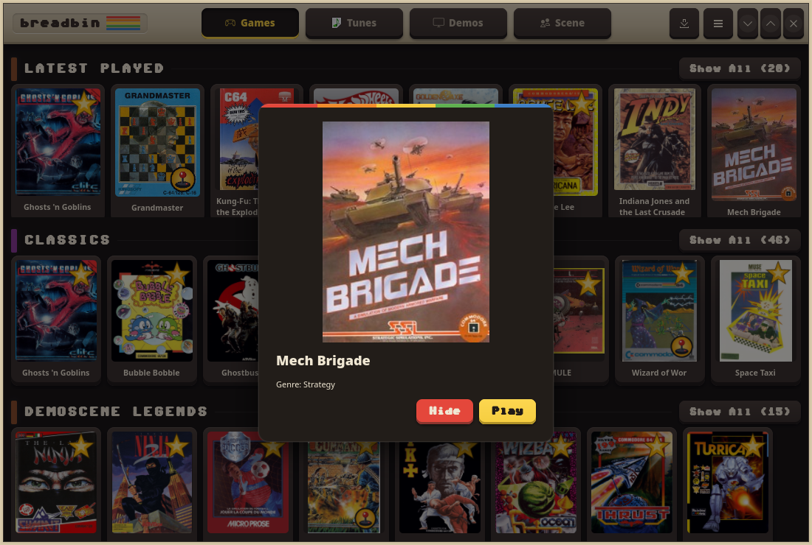
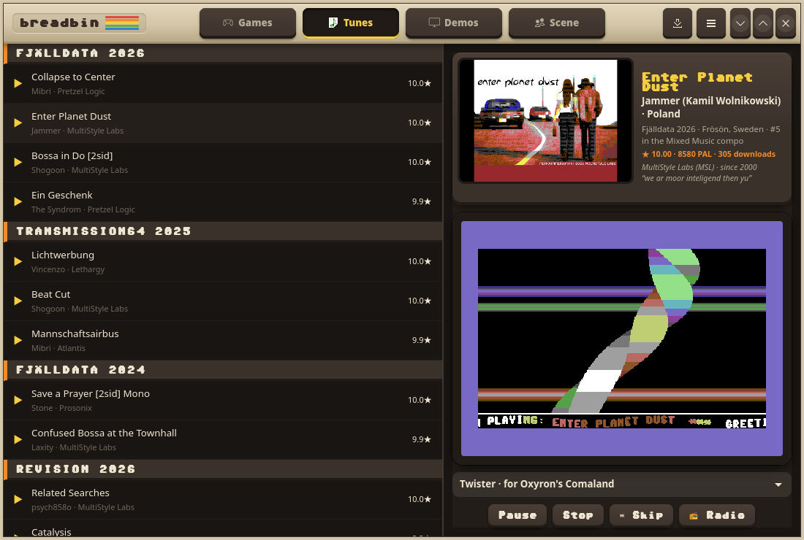
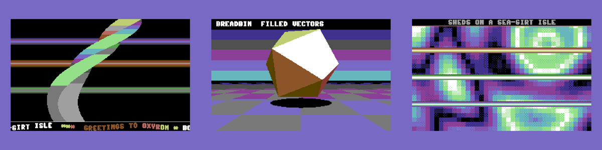
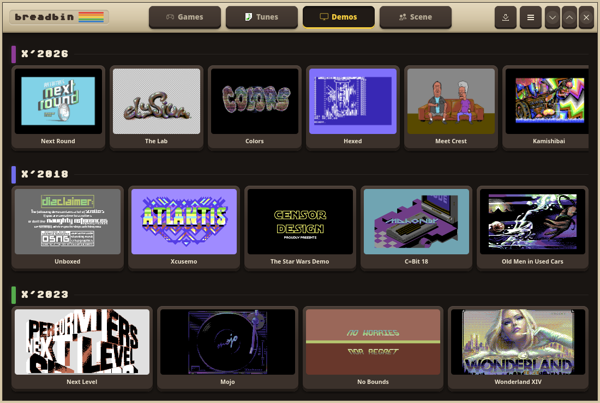
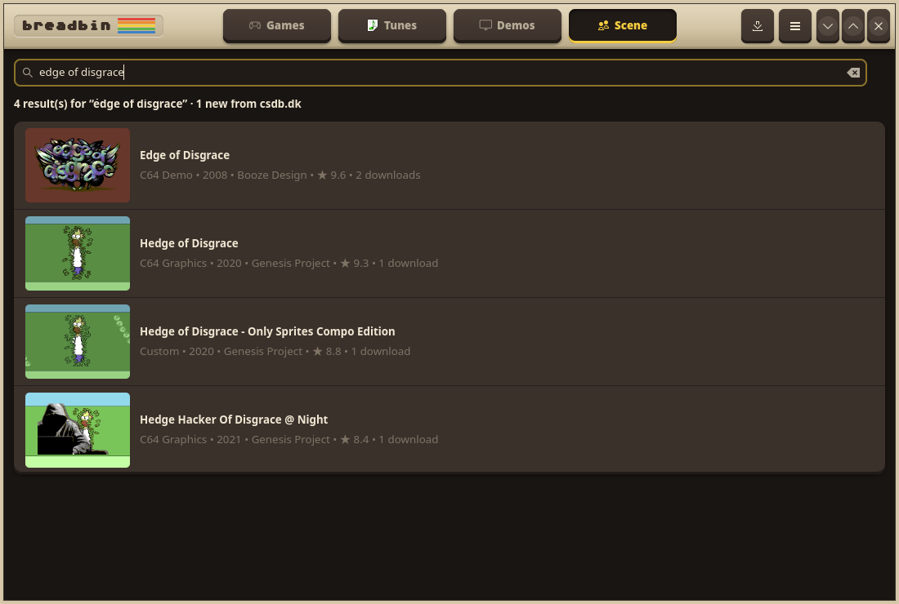
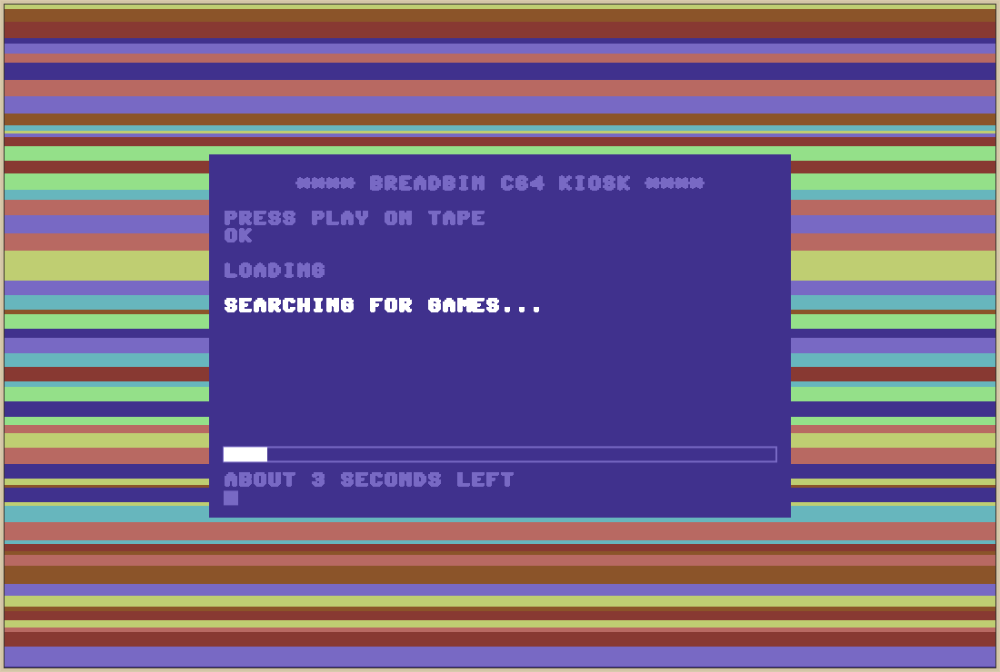

# Breadbin

**Your Commodore 64, on a shelf.** Breadbin is a native Linux app that turns
a pile of `.d64` files into a cover-art kiosk. It also browses the demoscene
and plays the best SID music ever written, with the visuals to go with it.

It's named after the "breadbin", the beige case that sat on desks in a
million bedrooms, and it's styled after that hardware. The header is the
case, the cards are keycaps, the Commodore rainbow stripe runs through it,
and the text is a C64 pixel font. Pick a game and it boots in VICE:
`LOAD"*",8,1` without the typing.



## A tour

### Games

Your collection and the C64 classics, ranked by GameBase64 ratings and how
often the Internet Archive's copy gets downloaded. Shelves for *latest
played*, the GameBase64 *classics*, curated collections and every genre.
Joystick games carry a joystick badge and top-rated ones a star. Genres
with more than eight games get **Show All**, which slides open the full grid.

Click a cover for the box art and **Play**. Games you don't own yet get
**Download**: breadbin fetches them from the Internet Archive and they land
in your collection.



### Tunes

A SID jukebox of CSDb's highest-rated music, grouped by the party where each
tune was released. Breadbin downloads each SID before the row lights up, so
every ▶ plays and dead links show a ✕ instead of an error. While a tune
plays, the now-playing card shows what CSDb knows about it: the release
screenshot, the composer's real name and country, the party and compo
placing, the SID chip, and the group and its slogan.



The visualiser is a real 320×200 C64 framebuffer in the Pepto palette. The
border flashes on the beat and each of the SID's three voices drives its own
raster bars. There are three effects, each a nod to a classic demo:

- **Twister**, for Oxyron's *Comaland*: a raster twister with a sine scroller of greetings
- **Filled Vectors**, for Booze Design's *Edge of Disgrace*: a shaded polyhedron over a checkerboard floor
- **Char Plasma**, for Crest & Oxyron's *Deus Ex Machina*: a PETSCII-style plasma with SID raster bars



### Demos

The same shelves for the demoscene, grouped by demoparty, from CSDb's
top-rated demos. Click one to download it and run it in VICE.



### Scene

Search CSDb's releases by name or with filters such as `type:demo year:1994`
or `group:oxyron`. Your local cache answers first. When it has few hits,
breadbin asks csdb.dk itself, streams the results in and caches them, so the
same search works offline next time.



### Loading screen

Breadbin starts on a C64 tape-loader screen, with flickering raster stripes
in the border and a time-left estimate. The estimate comes from how long each
step took on your last start. On a fresh install the same screen walks you
through the first-run catalogue build, from the GameBase64 download to the
Internet Archive scan.



## In your browser

**[jacobandresen.github.io/breadbin/play](https://jacobandresen.github.io/breadbin/play/)** runs
breadbin in a web page, with nothing to install and no Commodore ROMs needed:

- **Games and demos** start in [vc64web](https://vc64web.github.io/) (VirtualC64 compiled
  to WebAssembly), booting the free [MEGA65 Open ROMs](https://github.com/MEGA65/open-roms).
  Without a 1541 drive ROM, breadbin serves the disk itself: its virtual drive answers the
  KERNAL's LOAD from the D64 image, so single-file games, intros and KERNAL-loading titles
  run. Titles with their own fast loader need a real drive ROM; if you own the ROMs, add
  them under Settings (they stay in your browser).
- **Tunes** play through breadbin's own SID player (reSID plus a 6502 driver, compiled to
  WebAssembly) with the same three visualisers.
- **Nothing is bundled.** Each shelf is one small request made when it scrolls into view:
  the Internet Archive for games and demos, CSDb for rankings and scene details, hvsc.de for
  SID files, and libretro-thumbnails for box art. Everything is cached in the browser.

csdb.dk only lets sites on its allowlist read it from a web page, so CSDb requests go
through a relay: [r.jina.ai](https://jina.ai/reader/) by default (text only, about 20
requests a minute), or your own. `docs/play/relay/worker.js` is a Cloudflare Worker that
also passes CSDb's demo downloads through; set its URL under Settings.

To work on it locally:

```sh
make serve-web   # builds the SID player to WebAssembly, serves docs/ on :8064
```

## Requirements

| Dependency | Purpose |
| --- | --- |
| [C64 Forever](https://www.c64forever.com/) | The licensed Commodore ROMs and the VICE build that plays games and demos (breadbin never downloads ROMs) |
| GTK 4 + libadwaita | UI toolkit (usually pre-installed on modern desktops) |

Breadbin finds C64 Forever's bundled VICE automatically when it's installed
under wine at `/opt/wine/.wine`. Browsing, downloading and the SID player all
work without it. Only **Play** needs it.

Point breadbin at your game collection with `C64_LIB` (default
`~/Games/Commodore/C64`):

```sh
export C64_LIB="/path/to/your/c64/games"
```

## Install

### Arch Linux (recommended)

Build and install system-wide (build runs as you; only the install step needs root):

```sh
packaging/install.sh build   # cargo build --release (as your user)
sudo packaging/install.sh    # copy files into /usr (as root)
```

Then launch from your application menu or run `breadbin` in a terminal.

To build an AUR-style package instead:

```sh
cd packaging/arch
makepkg -si
```

### Ubuntu / Debian

```sh
packaging/install.sh build
sudo packaging/install.sh
```

Or build a `.deb`:

```sh
cp -r packaging/debian debian
dpkg-buildpackage -us -uc -b
sudo apt install ../breadbin_*.deb
```

(Use `apt install`, not `dpkg -i`, so dependencies like GTK4/libadwaita get pulled in
automatically. If you already used `dpkg -i` and hit dependency errors, run
`sudo apt-get install -f` to fix it.)

### From source (dev loop)

```sh
cargo build          # debug build — no --release needed
./breadbin.sh        # sets GSETTINGS_SCHEMA_DIR and launches
```

`breadbin.sh` picks up `target/release/breadbin` if present, falls back to
`target/debug/breadbin`.

## How data is managed

Breadbin keeps everything in `~/.breadbin/` (override with `BREADBIN_HOME`).
Nothing is bundled. The first run downloads and builds what it needs, and
everything after that is cached:

| File / folder | Contents |
| --- | --- |
| `c64_index.tsv`, `ia_index.tsv` | Ranked game catalogue (GameBase64 + Internet Archive) |
| `gb64.sqlitedb` | GameBase64 database (~17 MB, downloaded once) |
| `covers/` + `covers_index.tsv` | Box-art thumbnails (Libretro set) |
| `demos_index.tsv`, `demos/` | Demoscene catalogue and downloads |
| `tunes_index.tsv`, `sids/`, `tune_info/` | SID catalogue, verified SID files, CSDb details and screenshots |
| `csdb_cache_diesel.sqlite` | Searchable CSDb release cache |
| `played.tsv`, `hidden.tsv`, `downloaded.tsv` | Your play history, hidden games and downloads |
| `startup_timings.tsv` | How long each start-up step took, for the loading screen's estimate |

Use **Refresh catalogue** in the header menu (☰) to rebuild the game index,
and **Sync CSDb data** to refresh the release cache.

## Configuration

Launch options are GSettings keys:

```sh
gsettings set io.github.jacobandresen.Breadbin warp false               # load at authentic speed
gsettings set io.github.jacobandresen.Breadbin fullscreen-launch false  # run VICE in a window
gsettings set io.github.jacobandresen.Breadbin drive-sound false        # silence the 1541
```

## Command line

The CSDb cache can also be managed without the GUI:

```sh
breadbin sync [--count N]                     # cache the top N CSDb demos and music (default 100)
breadbin search <query> [--limit N] [--online] # search the cache, or csdb.dk with --online
breadbin has-data
```

### Troubleshooting launches

| Variable | Effect |
| --- | --- |
| `C64_VICE_LOG=1` (or a path) | VICE writes a verbose log to `~/.breadbin/vice.log` (or that path) |
| `C64_VIRTUAL_DRIVE=1` / `=0` | Force VICE's virtual drive / True Drive Emulation. By default breadbin uses the virtual drive when no 1541 ROM is installed |
| `C64_JOYSTICK=1` / `=0` | Override joystick detection |

## Credits

Game data comes from [GameBase64](https://www.gb64.com/), the
[Internet Archive](https://archive.org/details/softwarelibrary_c64) and the
[Libretro thumbnails](https://github.com/libretro-thumbnails/Commodore_-_64).
Scene data comes from [CSDb](https://csdb.dk/). Thanks to everyone who keeps
the C64 preserved.

The [Sixtyfour](https://github.com/jenskutilek/homecomputer-fonts) font by Jens
Kutílek is embedded under the SIL Open Font License
(`crates/breadbin-gui/data/fonts/OFL.txt`).
