# Breadbin

**A Commodore 64 in a browser tab.** Play the classics, hear the SID greats,
or make your own game. Nothing to install, no Commodore ROMs needed.

### [▶ Play now](https://jacobandresen.github.io/breadbin/play/)

[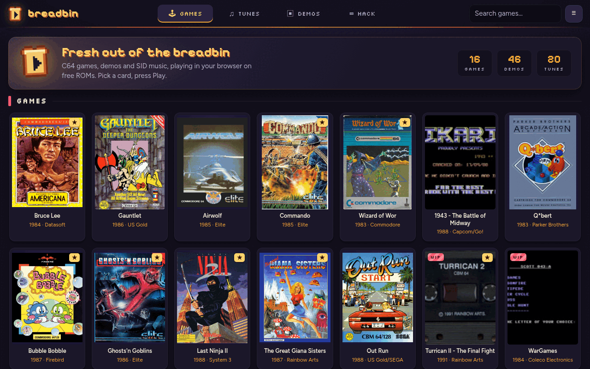](https://jacobandresen.github.io/breadbin/play/)

Named after the case that sat on a million bedroom desks, Breadbin dresses the
C64 as a midnight bakery: plum-ink night, warm toast, pixel type.

## Play

**16 games**, Bruce Lee to Out Run. **46 demos**, 1980s intros to trackmos like
Edge of Disgrace, running on a free 1541 DOS. Pick a card, press Play, or
click a picture below to start it.

| | |
|:---:|:---:|
| [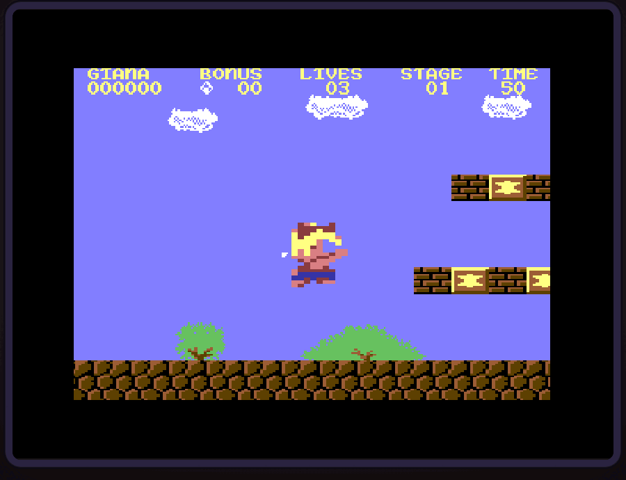](https://jacobandresen.github.io/breadbin/play/#games/gb64%3Ag2%2FGIANA1_03275_02.zip/play) | [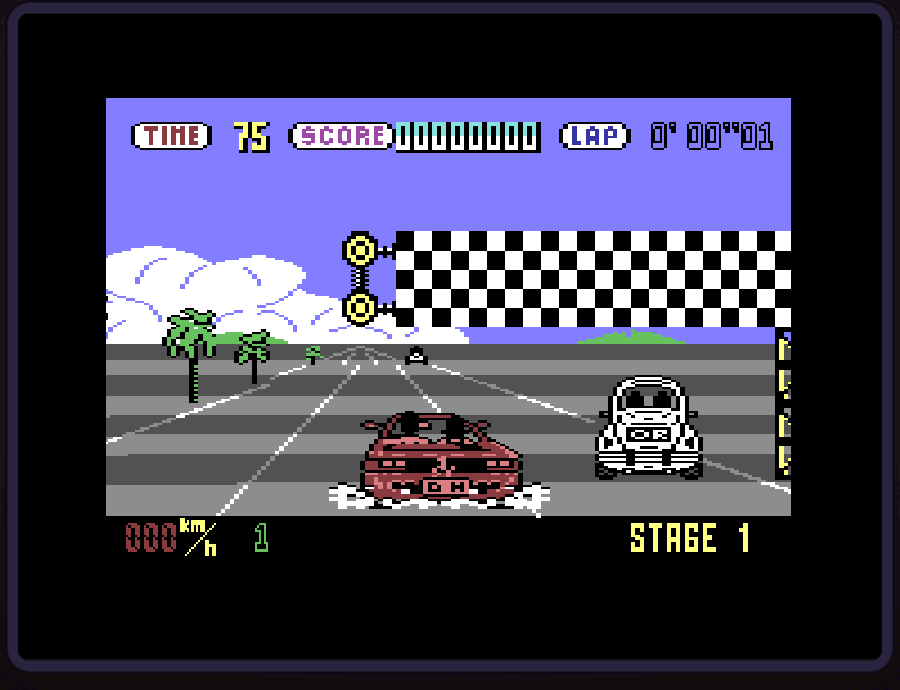](https://jacobandresen.github.io/breadbin/play/#games/gb64%3Ao%2FOUTRUN-E_05482_01.zip/play) |
| *The Great Giana Sisters* | *Out Run* |
| [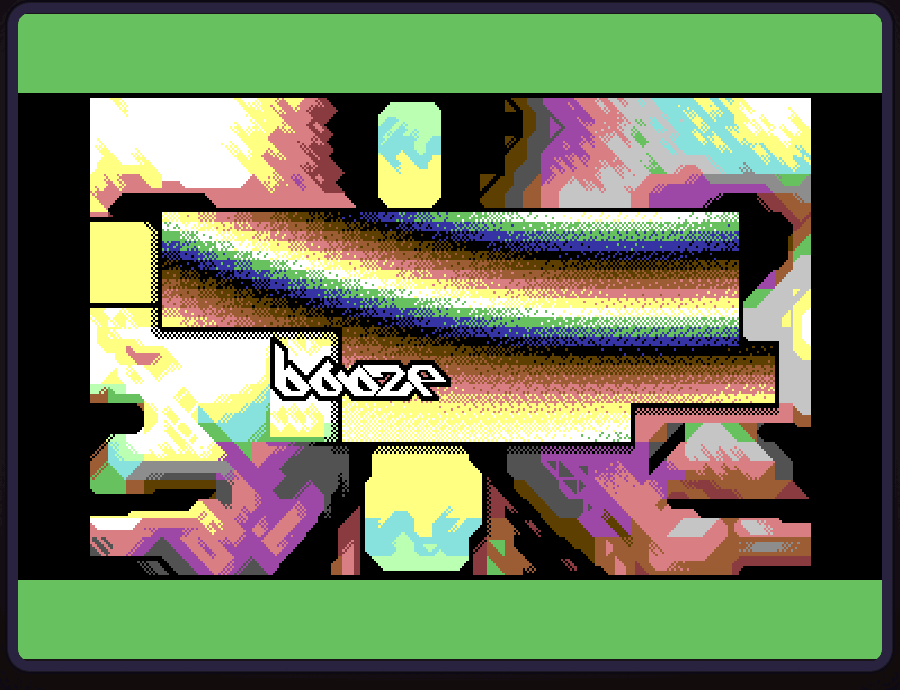](https://jacobandresen.github.io/breadbin/play/#demos/Edge_of_Disgrace_2008_Booze_Design_Side_A/play) | [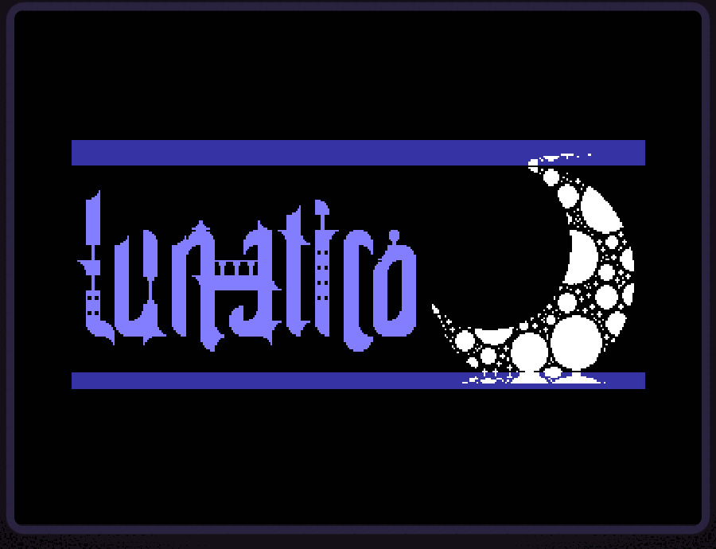](https://jacobandresen.github.io/breadbin/play/#demos/Lunatico_2016-10-29_Lft_Side_A/play) |
| *Edge of Disgrace*, Booze Design | *Lunatico* |

On a phone the player grows an arcade stick and a big red button.

[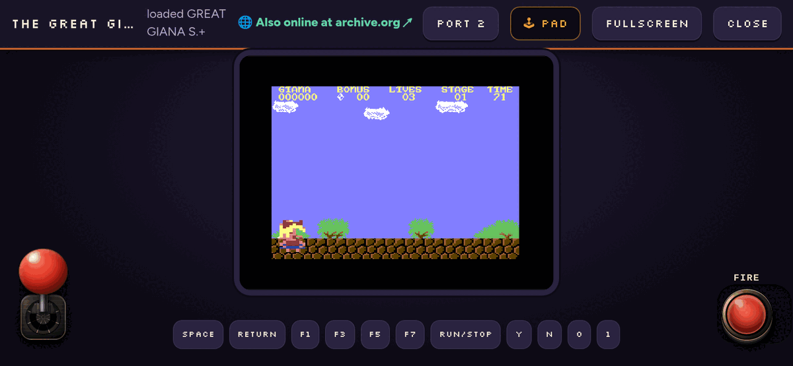](https://jacobandresen.github.io/breadbin/play/#games/gb64%3Ag2%2FGIANA1_03275_02.zip/play)

## Listen

**20 SID classics** by Hubbard, Galway, Hülsbeck and friends, stereo for 2SID
and 3SID tunes, with visualisers that tip their hat to Comaland, Edge of
Disgrace and Deus Ex Machina.

[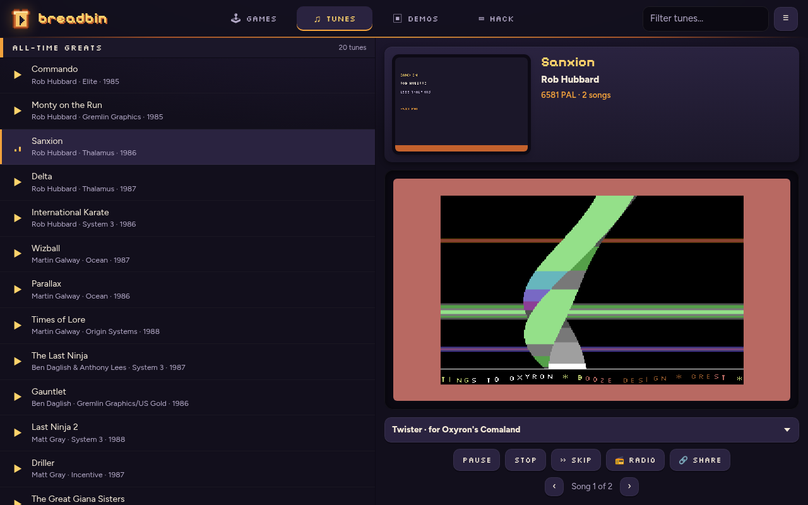](https://jacobandresen.github.io/breadbin/play/#tunes/%2FMUSICIANS%2FH%2FHubbard_Rob%2FSanxion.sid/play)

## Make

The **Hack** tab is a game studio for the C64. Write C, paint sprites and
tiles, lay out rooms, compose for the SID, and press **▶ Run**: the game
starts on the C64 beside the code, built in a third of a second.

[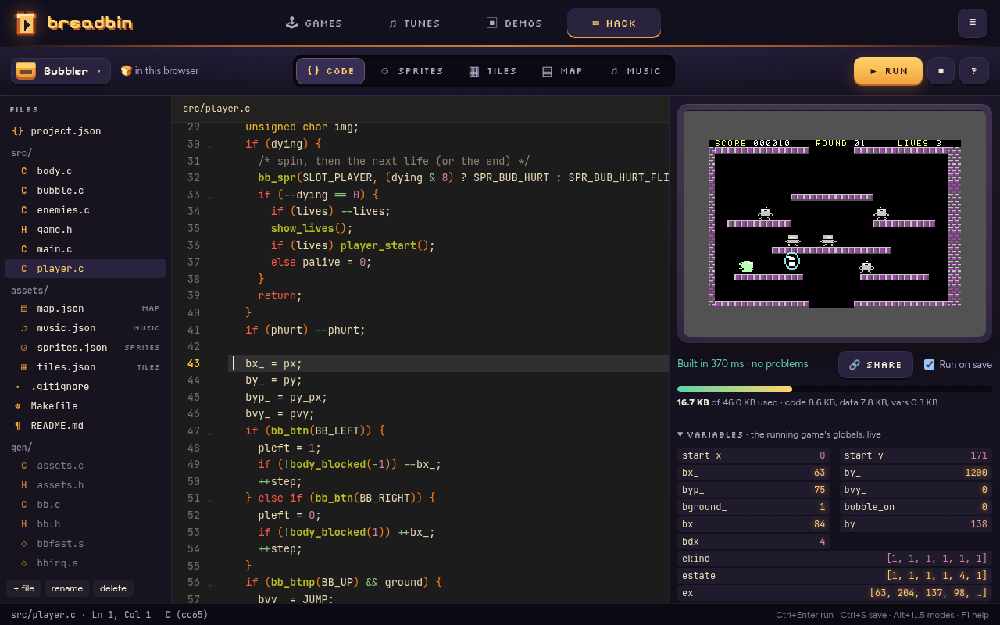](https://jacobandresen.github.io/breadbin/play/#hack)

| | |
|:---:|:---:|
| [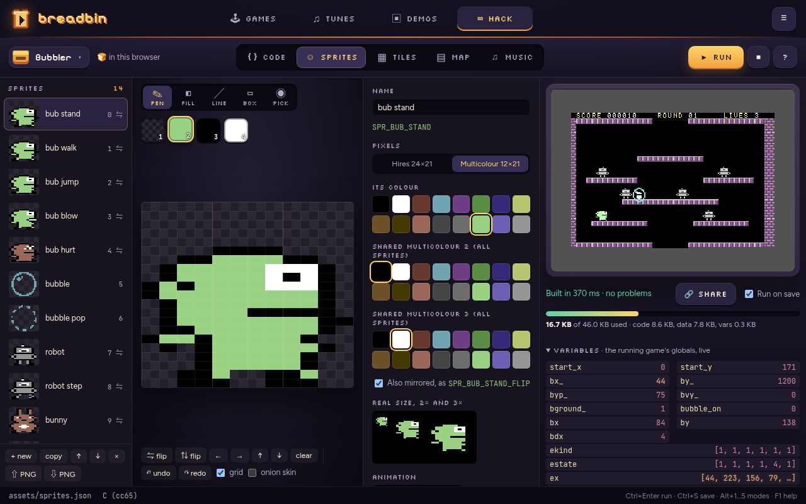](https://jacobandresen.github.io/breadbin/play/#hack) | [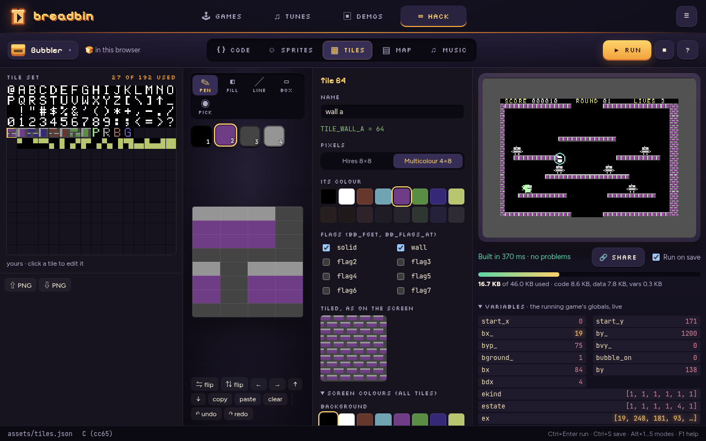](https://jacobandresen.github.io/breadbin/play/#hack) |
| *Sprites* | *Tiles* |
| [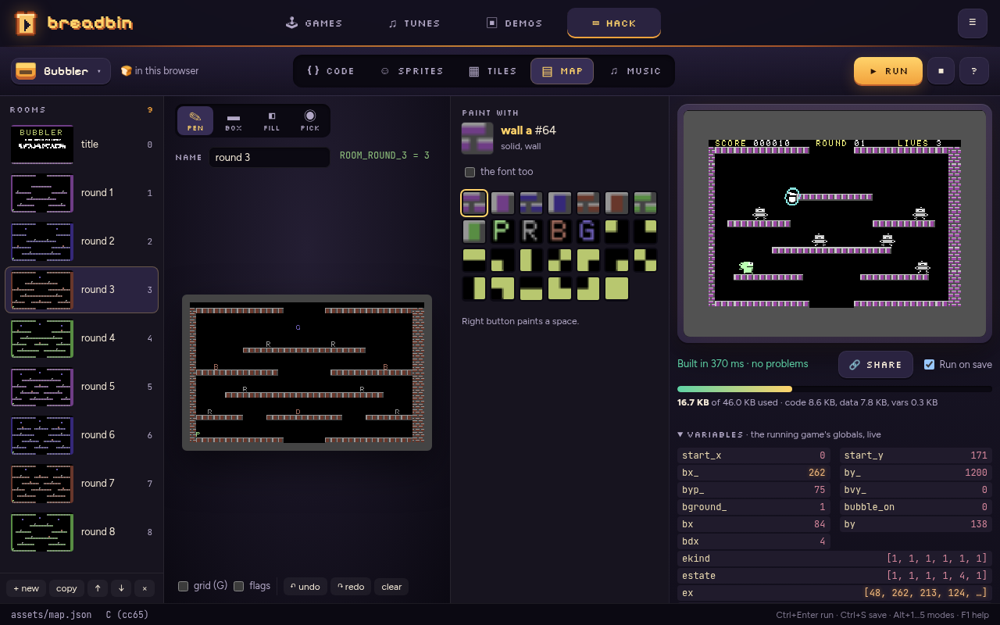](https://jacobandresen.github.io/breadbin/play/#hack) | [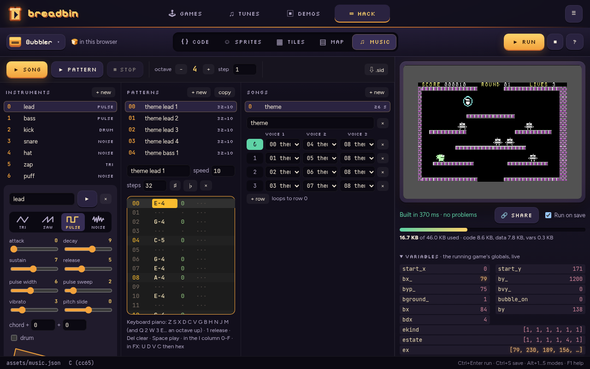](https://jacobandresen.github.io/breadbin/play/#hack) |
| *Rooms* | *Music* |

- **Real tools**: the cc65 C compiler, compiled to WebAssembly, in an editor in
  Neovim's retrobox colours with completion, go to definition and errors on the line.
- **Your disk**: work in a folder, edit in your own editor, commit to git; a
  native `make` builds the same program, byte for byte.
- **Two games to start from**, after blip's Bubbler and Bouncer, at a full 50
  frames a second, and **Pixels**, a tour of lines, circles and blits.
- **Peek, poke and pixels**: a 320x200 bitmap with blits thirty times faster
  than plotting.
- **Share** a link with the whole game inside it.

The [Studio guide](tools/studio/README.md) has a first tutorial, the runtime
and how it all works.

## Share

Every game, demo and tune has a **Share** link that starts it for whoever
opens it: the phone's share sheet, or copied on a computer.

## Playtested, honestly

A robot plays everything before you do. `tools/playtest` runs each title in
headless Chromium, gets past the menus, then checks that the stick moves the
player, demos move and make sound, and tunes stay audible. Anything not yet
passing stays on the shelf with a **WIP** badge and the reason. The Studio has
its own 100-odd tests, from the SID player's registers to robots playing its
games (`make test-studio`, `make test-studio-browser`).

```sh
make serve-web &               # build everything, serve docs/ on :8064
cd tools/playtest && npm install
node playtest.mjs games        # also: demos, tunes; --ids <substring> to filter
node playtest.mjs write        # results.json -> docs/play/verified.json
node links.mjs                 # every Share link starts what it names
```

`make serve-web` needs Rust's `wasm32-unknown-unknown` target, emscripten and
Node. See [`tools/playtest`](tools/playtest/README.md) for how a pass is decided.

## How it works

- **Emulator**: [vc64web](https://vc64web.github.io/) (VirtualC64 in
  WebAssembly) on the free [MEGA65 Open ROMs](https://github.com/MEGA65/open-roms).
  Own the Commodore ROMs? Add them under Settings; they stay in your browser.
- **Disks**: a virtual drive answers the KERNAL's LOAD straight from the D64.
  Trackmos, whose loaders run code in the drive, get an emulated 1541 with
  [Pascual DOS](https://github.com/Pascual-Candel-Palazon/Pascual_DOS-1541)
  and breadbin's patch for fast loaders (`tools/drive`).
- **Engine**: the virtual drive, disk images, visualisers and SID player (reSID
  on a small cycle-counted C64) are Rust compiled to WebAssembly
  (`crates/breadbin`). JavaScript (`docs/play`) does the page.
- **Studio**: cc65, ca65 and ld65 built to WebAssembly (`tools/studio`),
  CodeMirror 6, and a small C64 runtime with a SID player
  (`docs/play/studio/runtime`).
- **Data**: nothing is bundled. Shelves load as they scroll into view, from
  GameBase64 and the Internet Archive, the Archive's copy of HVSC 79, and
  libretro-thumbnails. The only ROM breadbin ships is its own build of the free
  1541 DOS.
- **CSDb**: demo and tune details go through a relay
  ([r.jina.ai](https://jina.ai/reader/) by default, or your own:
  `docs/play/relay/worker.js` is a Cloudflare Worker for it).

## Credits

Breadbin runs on free software, each under its own licence:

- [vc64web](https://github.com/vc64web/virtualc64web) by mithrendal, on
  [VirtualC64](https://github.com/dirkwhoffmann/virtualc64) by Dirk W. Hoffmann:
  the emulator (GPL-3.0), loaded from vc64web.github.io.
- [MEGA65 Open ROMs](https://github.com/MEGA65/open-roms): the free KERNAL,
  BASIC and character set (LGPL-3.0), patched in the browser
  (`crates/breadbin/src/rom.rs`).
- [Pascual DOS](https://github.com/Pascual-Candel-Palazon/Pascual_DOS-1541) by
  Pascual Candel Palazón: the free 1541 DOS (MIT), with breadbin's patch.
- [resid-rs](https://github.com/digitalstreamio/resid-rs), the Rust port of
  Dag Lem's reSID: the SID (GPL-3.0).
- [Exomizer](https://bitbucket.org/magli143/exomizer) by Magnus Lind: its
  decruncher, ported to Rust for EasySplit files (zlib-style licence).
- [EasyFlash](https://skoe.de/easyflash/) by Thomas Giesel: the cartridge and
  EasySplit formats.
- [cc65](https://cc65.github.io/): the C compiler, assembler, linker and C64
  library of the Studio (zlib licence).
- [ACME](https://github.com/meonwax/acme) by Marco Baye: the Studio's assembler
  for the classic intros (GPL-2.0).
- [CodeMirror](https://codemirror.net/) by Marijn Haverbeke: the code editor
  (MIT). Its colours follow Neovim's retrobox (after gruvbox by morhetz).
- [blip-deck](https://github.com/jacobandresen/blip-deck): the touch pad's
  arcade stick and buttons (MIT), loaded from jsDelivr at a pinned tag.
- Pixelify Sans, Silkscreen, Figtree and JetBrains Mono from Google Fonts (SIL
  Open Font License).

The games, demos and music are the work of their coders, musicians,
graphicians and crackers, credited on every card from the scene's own records:
[GameBase64](https://www.gb64.com/), the
[Internet Archive](https://archive.org/details/softwarelibrary_c64),
[CSDb](https://csdb.dk/), the
[High Voltage SID Collection](https://www.hvsc.de/) and
[libretro-thumbnails](https://github.com/libretro-thumbnails/Commodore_-_64).
Thanks to everyone who keeps the C64 preserved.
