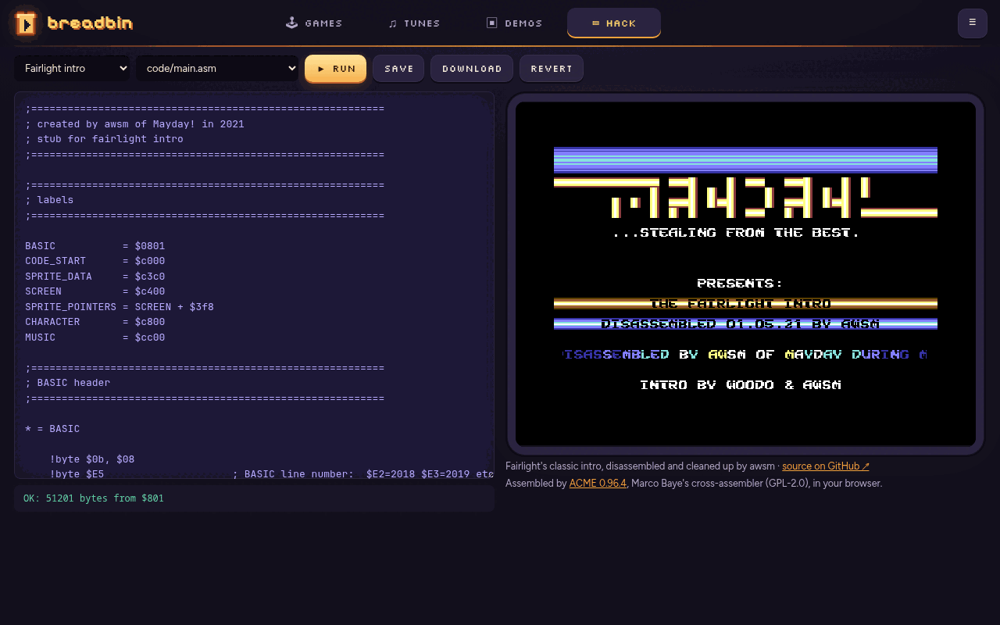

# Breadbin

**Your Commodore 64, in a browser tab.** Pick a card, press Play. Nothing to
install, no Commodore ROMs needed.

### [▶ Play now](https://jacobandresen.github.io/breadbin/play/)

[](https://jacobandresen.github.io/breadbin/play/)

Named after the nickname of the case that sat on desks in a million bedrooms,
Breadbin dresses the C64 as a midnight bakery: plum-ink night, warm toast and
butter, and pixel type on every shelf.

## What's on the shelf

**16 games**, from Bruce Lee to Out Run. **46 demos**, from the 1980s to
trackmos like Edge of Disgrace and Lunatico, running on a free 1541 DOS.

| | |
|:---:|:---:|
|  |  |
| *The Great Giana Sisters* | *Out Run* |
|  |  |
| *Edge of Disgrace*, Booze Design | *Lunatico* |

**20 SID classics** by Hubbard, Galway and friends, with stereo for 2SID and 3SID
tunes and three visualisers in a real 320x200 framebuffer, each a nod to a
classic demo (Comaland, Edge of Disgrace, Deus Ex Machina).


**Hack** puts an assembler in the page. Open a classic intro's source or write
your own, press Run, and ACME builds it and starts it on the C64 beside the code.



**On a phone or tablet** the player grows a ball-top arcade stick, a red button
and the keys games ask for.


## Playtested, honestly

A robot plays everything before you do. `tools/playtest` runs each title in
headless Chromium: it gets past the menus and trainers, then checks that the
stick really moves the player, that demos move and make sound, and that tunes
stay audible. Anything that hasn't passed yet stays on the shelf with a **WIP**
badge and the reason.

```sh
make serve-web &               # build the engine, serve docs/ on :8064
cd tools/playtest && npm install
node playtest.mjs games        # also: demos, tunes; --ids <substring> to filter
node playtest.mjs write        # results.json -> docs/play/verified.json
```

`make serve-web` needs Rust's `wasm32-unknown-unknown` target and emscripten.
See [`tools/playtest`](tools/playtest/README.md) for how a pass is decided.

## How it works

- **Emulator**: [vc64web](https://vc64web.github.io/) (VirtualC64 in
  WebAssembly) on the free [MEGA65 Open ROMs](https://github.com/MEGA65/open-roms).
  Own the Commodore ROMs? Add them under Settings; they stay in your browser.
- **Disks**: a virtual drive answers the KERNAL's LOAD straight from the D64,
  and steps around the places where the Open ROMs differ from the originals.
  Trackmos, whose loaders run code in the drive itself, get an emulated 1541
  with [Pascual DOS](https://github.com/Pascual-Candel-Palazon/Pascual_DOS-1541)
  and breadbin's patch for fast loaders (`tools/drive`).
- **Engine**: the virtual drive, disk images, visualisers and SID player (reSID
  driven by a small cycle-counted C64, enough for digi tricks) are Rust compiled
  to WebAssembly (`crates/breadbin`). JavaScript (`docs/play`) does the page.
- **Data**: nothing is bundled. Shelves load as they scroll into view, from
  GameBase64's collection and the demos on the Internet Archive, the Archive's
  copy of HVSC 79, and libretro-thumbnails. The only ROM breadbin ships is its
  own build of the free 1541 DOS.
- **CSDb**: csdb.dk only lets allowlisted sites read it from a web page, so demo
  and tune details go through a relay:
  [r.jina.ai](https://jina.ai/reader/) by default, or your own
  (`docs/play/relay/worker.js` is a Cloudflare Worker for it).

## Credits

Breadbin runs on free software, each under its own licence:

- [vc64web](https://github.com/vc64web/virtualc64web) by mithrendal, on
  [VirtualC64](https://github.com/dirkwhoffmann/virtualc64) by Dirk W. Hoffmann:
  the emulator (GPL-3.0), loaded from vc64web.github.io.
- [MEGA65 Open ROMs](https://github.com/MEGA65/open-roms): the free KERNAL,
  BASIC and character set (LGPL-3.0). Breadbin patches the KERNAL in the
  browser (`crates/breadbin/src/rom.rs`, its fixes listed there).
- [Pascual DOS](https://github.com/Pascual-Candel-Palazon/Pascual_DOS-1541) by
  Pascual Candel Palazón: the free 1541 DOS (MIT), with breadbin's patch
  (`tools/drive`, MIT as well).
- [resid-rs](https://github.com/digitalstreamio/resid-rs), the Rust port of
  Dag Lem's reSID: the SID of the music player (GPL-3.0).
- [Exomizer](https://bitbucket.org/magli143/exomizer) by Magnus Lind: its
  decruncher, ported to Rust to unpack EasySplit files (`crates/breadbin/src/exo.rs`,
  under Exomizer's zlib-style licence).
- [EasyFlash](https://skoe.de/easyflash/) by Thomas Giesel: the cartridge and
  EasySplit formats.
- [blip](https://github.com/jacobandresen/blip): the control deck of the touch
  pad, its ball-top arcade stick and red arcade button (MIT).
- [ACME](https://github.com/meonwax/acme) by Marco Baye: the assembler of the
  Hack tab, built to WebAssembly (GPL-2.0).
- Pixelify Sans, Silkscreen and Figtree from Google Fonts (SIL Open Font License).

The games, demos and music are the work of their coders, musicians,
graphicians and crackers, credited on every card from the scene's own records:
files and facts from [GameBase64](https://www.gb64.com/) and the
[Internet Archive](https://archive.org/details/softwarelibrary_c64), scene data
from [CSDb](https://csdb.dk/), music from the
[High Voltage SID Collection](https://www.hvsc.de/) and box art from
[libretro-thumbnails](https://github.com/libretro-thumbnails/Commodore_-_64).
Thanks to everyone who keeps the C64 preserved.
