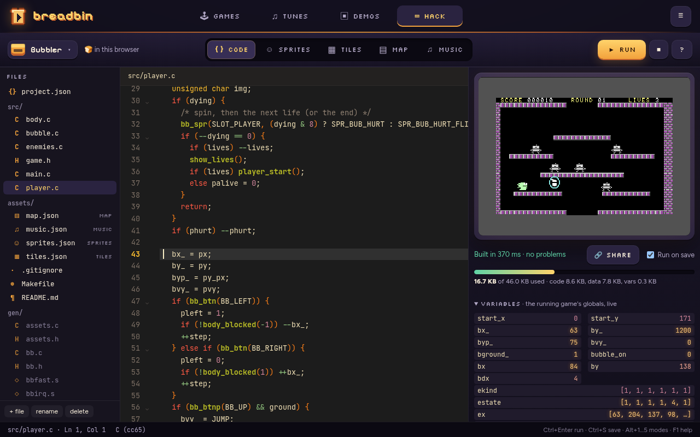

# The Studio

The Hack tab is a small game studio for the C64:
one project at a time, five modes, and a C64 beside them that runs the game
when you press **▶ Run**.

| Mode | What you make there | Saved as |
|---|---|---|
| **Code** | the game, in C (cc65) or 6502 assembly (ca65, ACME) | `src/*.c`, `*.h`, `*.s` |
| **Sprites** | the C64's 24×21 hardware sprites, hires or multicolour | `assets/sprites.json` |
| **Tiles** | the 256 characters of the screen, with colours and flags | `assets/tiles.json` |
| **Map** | rooms: screens of 40×25 tiles | `assets/map.json` |
| **Music** | SID instruments, tracker patterns, songs and sound effects | `assets/music.json` |



Everything runs in the browser: the compiler is cc65 compiled to
WebAssembly, the C64 is vc64web on the free MEGA65 Open ROMs, the music
plays on breadbin's own SID engine. Nothing is installed.

- [Making a game](#making-a-game)
- [Saving to your disk](#saving-to-your-disk)
- [The runtime: bb.h](#the-runtime-bbh)
- [The asset files](#the-asset-files)
- [Music and sound effects](#music-and-sound-effects)
- [The C64's limits, and making C fast](#the-c64s-limits-and-making-c-fast)
- [How the Studio works](#how-the-studio-works)
- [Building and testing the Studio](#building-and-testing-the-studio)

## Making a game

Open the Hack tab. The Studio starts on **Bubbler**, a one-screen platformer
(after blip's Bubbler); the projects menu (the cartridge, top left) has
**Bouncer** (bricks and a bat, after blip's Bouncer), **Pixels** (a tour of
the bitmap mode, blits and peek/poke), an **Empty game** to start from, and three classic intros in ACME assembly. Each example opens as
its own copy: change anything, and **↺ Reset example** brings it back.

Press **▶ Run** (Ctrl+Enter). The Studio writes `gen/` from the assets,
compiles every `.c` and `.s` file, links them with the runtime, and starts the
program on the C64 on the right. The joystick is the cursor keys and space
(click the C64 first). A second Run reloads the running C64 in a second or
so. With **Run on save** ticked, saving (Ctrl+S) runs again too, and so does
saving a file in your own editor when the project is in a folder.

Compiler errors show under the C64 and as red underlines in the code; click
one to go to its line. The bar under the C64 is the memory the program uses,
of the 46 KB it has. **Variables** (under it, folded) shows the running game's
global variables, read from the C64 four times a second: a debugger's watch
list, for seeing what the game thinks is going on.

Art made elsewhere comes in with **⇧ PNG** in SPRITES (a 24×21 picture, or a
sheet of them) and TILES (cut into 8×8): each picture becomes the nearest
colours the C64 can show there. **⇩ PNG** saves the sprites or the tile set as
one picture, to edit in Aseprite or anything else and import back.

| Keys | |
|---|---|
| Ctrl+Enter, Ctrl+R | build and run (Ctrl+Enter works while the C64 has the keyboard, too) |
| Esc (on the C64) | back to the code |
| Ctrl+S | save now (it saves by itself, too) |
| Alt+1 … Alt+5 | Code, Sprites, Tiles, Map, Music |
| F1, ? | the cheat sheet: every call in bb.h |
| Ctrl+Space | complete: the runtime, the asset names, cc65's library (from the `<headers>` the file includes), words in the file |
| F12, Ctrl+click | go to where a name is defined: a function, a variable, a `#define`, an asset (`gen/assets.h`), a runtime call (`gen/bb.h`) |
| Ctrl+F, Ctrl+/ | find, comment a line |
| In the pixel editors | 1-4 colour slot, P F L R I pen fill line box pick, H V flip, arrows shift, [ ] previous/next, O onion skin (sprites: the frame before, faint, underneath), Ctrl+Z undo; the right button erases |

The code editor is CodeMirror 6 in **retrobox** colours, the
gruvbox-flavoured scheme that ships with Vim and Neovim: each colour is the
one `colors/retrobox.vim` gives the matching highlight group (`theme.js`).

### Your first change: coins to collect

Starting from the **Empty game** (projects menu → New project from… → Empty
game), a few minutes in each mode:

1. **Tiles**: click an empty slot (66, after the ground and the brick), paint
   a coin in yellow, name it `coin`, and tick its `pickup` flag. The code now
   has `TILE_COIN` and `FLAG_PICKUP`.
2. **Map**: pick the coin from the palette on the right and click a few into
   the room, above the ground and the bricks.
3. **Music**: under Patterns, **+ new**, name it `coin`, speed 2, and type a
   quick rising blip: click the first note cell, press `Q`, `E`, `T`, then `1`
   to release (C-5, E-5, G-5). That is `SFX_COIN`.
4. **Code**: in `src/main.c`, a counter at the top (`unsigned char coins;`)
   and, in the loop after the movement:

   ```c
   /* a coin under the hero's middle: take it */
   if (bb_flags_at(x + 12, y + 12) & FLAG_PICKUP) {
     bb_set_tile((x + 12) >> 3, (y + 12) >> 3, 32);   /* a space where it was */
     bb_sfx(SFX_COIN);
     bb_num(34, 1, ++coins, 3, BB_YELLOW);
   }
   ```

5. **▶ Run**, and walk into the coins.

(`tools/studio/test/build/tutorial.test.mjs` does these steps to the Empty
game's files and builds the result, so the tutorial keeps working.)

## Saving to your disk

A project lives in one of three places:

- **This browser** (the default): saved as you type, in IndexedDB. Nothing to
  set up; it stays with this browser.
- **A folder on your disk** (Chrome, Edge, Opera): projects menu → **💾 Save
  to a folder…**, or **📂 Open a folder…** for a project already on disk (or
  an empty folder, for a new one). From then on every save writes the real
  files, and every build writes `game.prg` next to them. The folder is a
  plain project:

  ```
  bubbler/
    project.json      name, language, entry file
    src/              your code
    assets/           sprites.json, tiles.json, map.json, music.json
    gen/              written by every build: the runtime and the assets as C
    Makefile          the same build with a native cc65: `make`
    README.md
    .gitignore        game.prg, game.map
  ```

  **📂 Open a folder…** also opens any folder of C or assembly that isn't a
  Studio project yet: an existing cc65 project builds as plain cc65 (no
  runtime, RAM to $D000), and SPRITES, TILES, MAP or MUSIC offer to start its
  assets, which brings in the runtime.

  Put it in git, edit it in Neovim: the Studio looks at the folder every
  second and a half while its tab is open, and takes in any file changed
  there (and runs it again, with Run on save). The browser remembers the
  folder; on the next visit it asks once to reopen it.

- **A zip** (any browser): **⇩ Export .zip** and **⇧ Import .zip…** carry a
  project in and out. Firefox and Safari have no folder access, so this is
  how a project gets to and from the disk there.

**⇩ Download .prg** saves the built program, for VICE (`x64sc game.prg`), an
SD card for a real C64, or anything else that runs PRGs.

**🔗 Share** (beside the build result, and in the projects menu) makes a link
that plays the game: the built program,
gzipped, is inside the link (`docs/play/cart.js`), so nothing is uploaded
anywhere. Whoever opens it gets the game in breadbin's player, with its touch
controls on a phone. Bubbler's link is about 10,000 characters.

`make` in the folder builds the same program, byte for byte, with a native
cc65 (`cl65 -t c64 -Oirs -Cl`, the files in sorted order, RAM to $C000); the
build tests check that it does.

## The runtime: bb.h

Every C project includes `bb.h` (the runtime) and `assets.h` (the names the
assets get). The smallest game:

```c
#include "bb.h"
#include "assets.h"

int x = 160;

int main(void) {
  bb_init();                      /* screen, tiles, sprites, music interrupt */
  bb_room(ROOM_START);            /* a room from MAP */
  bb_music(SONG_TUNE);            /* a song from MUSIC */
  for (;;) {
    bb_frame();                   /* wait for the next frame: 50 a second */
    if (bb_btn(BB_LEFT)) --x;
    if (bb_btn(BB_RIGHT)) ++x;
    if (bb_btnp(BB_FIRE)) bb_sfx(SFX_BLIP);
    bb_spr(0, SPR_HERO, x, 100);  /* hardware sprite 0, an image from SPRITES */
  }
}
```

| | |
|---|---|
| `bb_init()`, `bb_frame()`, `bb_frames` | start, wait for the next frame, the frame count |
| `bb_btn(b)`, `bb_btnp(b)`, `bb_joy()` | joystick held / just pressed (`BB_UP` `BB_DOWN` `BB_LEFT` `BB_RIGHT` `BB_FIRE`, either port) |
| `bb_spr(n, img, x, y)`, `bb_spr_hide(n)`, `bb_spr_color(n, c)` | hardware sprite `n` (0-7) as image `img` (`SPR_...`) at screen pixel x, y |
| `bb_overlap(...)` | do two boxes overlap |
| `bb_room(n)` | draw room `n` (`ROOM_...`) |
| `bb_tile(cx, cy)`, `bb_set_tile(cx, cy, t)` | the tile in a cell, put one there |
| `bb_fget(t)`, `bb_flags_at(x, y)` | a tile's flags (`FLAG_...`), the flags under a pixel |
| `bb_text(cx, cy, s, c)`, `bb_num(cx, cy, n, digits, c)`, `bb_cls(t, c)` | text and numbers in the font tiles |
| `bb_music(n)`, `bb_sfx(n)` | start a song (`SONG_...`, `BB_STOP`), play a pattern as a sound effect (`SFX_...`) |
| `bb_rnd()`, `bb_seed(s)` | random numbers |
| `bb_bitmap(ink, paper)`, `bb_textmode()` | the 320x200 bitmap, and back to tiles and text |
| `bb_pen(m)`, `bb_plot(x, y)`, `bb_pget(x, y)` | pixels, drawn with the pen: `BB_DRAW`, `BB_ERASE`, `BB_FLIP` (draw twice and it's gone), `BB_COPY` |
| `bb_line`, `bb_rect`, `bb_fill`, `bb_circle`, `bb_disc` | shapes |
| `bb_ink(cx, cy, w, h, ink, paper)`, `bb_btext(cx, cy, s)` | the cells' colours; text in the bitmap |
| `bb_blit(x, y, src, wb, h)`, `bb_grab(...)` | copy a picture onto the bitmap a byte (8 pixels) at a time, with the pen; or the bitmap into memory |
| `bb_peek(addr)`, `bb_poke(addr, v)`, `bb_peekw`, `bb_pokew` | read and write the C64's memory and chips |
| `bb_colors(border, bg, mc1, mc2)` | the screen's colours |

F1 in the Studio shows all of it with each call's description, read from
`bb.h`'s comments (`runtime/bb.h` is the reference). The asset names are in
`gen/assets.h`: a sprite named `bub walk` is `SPR_BUB_WALK`, with
`SPR_BUB_WALK_FLIP` after it if "also mirrored" is ticked (the C64 can't
mirror a sprite, so the Studio stores the mirror); a tile named `brick` is
`TILE_BRICK`, its flags `FLAG_SOLID`..., a room `ROOM_ROUND_1`, a song
`SONG_THEME`, a pattern `SFX_JUMP`.

**Memory.** The program has $0801-$BFFF (46 KB). The runtime keeps VIC bank 3
for the picture: the screen at $C000 (in bitmap mode, the cells' colours),
the 256 tiles at $C800, up to 64 sprite images at $D000 (in the RAM under the
I/O chips) and the 320x200 bitmap at $E000 (under the KERNAL ROM); the VIC
reads all of it. The pixel code (`gen/bbpixel.c`, `gen/bbdraw.s`) comes with
a project only when its code calls a pixel function: a game of tiles and
sprites stays 4 KB smaller.

**Pixels and blits.** In bitmap mode a plot costs a few hundred cycles; a blit
moves a byte, 8 pixels, for a few dozen. The **Pixels** example races them:
40 balls plotted take 386 frames, blitted 13. A blit's x is a multiple of 8,
so a thing that moves a pixel at a time keeps 8 copies of itself, each
shifted a pixel further: Pixels makes them by drawing a disc and grabbing it
(`bb_grab`), and moves its balls with the flip pen, which needs no saved
background. A raster interrupt at line 250 counts frames and plays the music;
the KERNAL's keyboard scan is off, so games read the joysticks.

## The asset files

All four are JSON, laid out to read and diff well (`project.js` `pretty()`):
pixel rows one per line, as text.

**sprites.json** - `{ "mc1", "mc2", "sprites": [...] }`. A sprite is
`{ "name", "multi", "color", "flip", "rows" }`: 21 rows of 24 hires pixels
(`.` see-through, `1` its colour) or 12 double-wide multicolour pixels (`1`
its colour, `2` and `3` the shared `mc1` and `mc2`).

**tiles.json** - `{ "colors": { "border", "bg", "mc1", "mc2" }, "flags":
[8 names], "tiles": [256] }`. A tile is `{ "name", "multi", "color", "flags",
"rows" }`: 8 rows of 8 hires pixels (`.` background, `1` its colour) or 4
multicolour ones (`1` its colour, `2` `3` the shared ones). A multicolour
tile's own colour is 0-7: a C64 limit (the build warns otherwise). Tiles 0-63
are the font, in screen-code order (the Studio's own font: no Commodore ROM
is used); `null` is an empty slot.

**map.json** - `{ "legend": { "#": 64, ... }, "rooms": [{ "name", "rows" }] }`:
each room is 25 rows of 40 characters, each character a tile through the
legend, like a level written by hand. The editor keeps the legend.

**music.json** - see [Music](#music-and-sound-effects).

The build turns them into `gen/assets.c` (the sprite images, the character
set, tile colours and flags, the rooms run-length coded) and `gen/music.s`.

## Music and sound effects

The MUSIC mode is a tracker for the SID's three voices.

- An **instrument** is a waveform (triangle, saw, pulse, noise), an envelope
  (attack, decay, sustain, release, 0-15 each), a pulse width and how fast it
  sweeps, a delayed vibrato, a chord (two semitone offsets played a frame each
  after the note: an arpeggio), a constant pitch slide, and "drum": a click of
  noise as the note starts.
- A **pattern** is up to 64 steps of `speed` frames (6 is 125 steps a
  minute). A step reads like a tracker's: `C-4 1 V04` is the note, the
  instrument (0-F) and an effect with its parameter in hex: `U` slide up, `D`
  slide down, `V` vibrato, `C` release after that many frames. `---` is
  nothing new, `===` releases the note.
- A **song** is rows of three patterns, one per voice (or a rest); a row
  lasts as long as its first voice's pattern. It loops back to the row marked
  ↻, or plays once.

The computer keyboard is a piano, as in most trackers: `Z S X D C V G B H N J
M ,` is an octave from C, `Q 2 W 3 E R 5 T 6 Y 7 U I` the one above; `1`
releases, Delete clears, Space plays the pattern, Enter the song.

**⇩ .sid** saves the music as a PSID file, each song a sub-tune, for any SID
player (sidplayfp, VLC, a real C64 with a SID player).

In the game, `bb_music(SONG_THEME)` plays a song and `bb_sfx(SFX_JUMP)` plays a
pattern once on the third voice, which it gives back to the song after.

What the editor plays is what the game plays: the game's player
(`runtime/bbsound.s`) and the music, assembled into a PSID file by the same
WebAssembly ca65 and played by breadbin's SID engine (reSID).

## The C64's limits, and making C fast

The C64 runs at 1 MHz: a frame is about 20,000 cycles, and cc65's C is
roughly ten times slower than hand-written assembly. Bubbler, with six
monsters, first ran at 17 frames a second; these got it to 50:

- **Static locals** (`-Cl`, on in the Studio and the Makefile): local
  variables at fixed addresses instead of on cc65's software stack. The one
  catch: a function can't call itself.
- **The busy calls in assembly**: `bb_spr`, `bb_flags_at`, `bb_overlap`,
  `bb_tile` and `bb_set_tile` are in `runtime/bbfast.s`. Arguments on cc65's
  stack cost hundreds of cycles; these read them directly.
- **Fewer calls**: Bubbler checks touches with a macro (`NEAR` in `game.h`):
  two unsigned compares instead of a function with eight arguments.
- **Spread the work**: each monster thinks every other frame, half of them on
  odd frames, moving twice as far when it does.
- **Avoid signed shifts and 16-bit maths in loops**: `y >> 4` on an `int` is a
  call. Bubbler keeps a monster's height in pixels next to its height in
  16ths.
- `unsigned char` wherever a value fits in 0-255.

Other limits: 8 hardware sprites on the screen at once, 64 sprite images
(mirrors count),
256 tiles (64 of them the font), 3 SID voices (sound effects borrow the
third), 46 KB for code and data.

## How the Studio works

```
docs/play/studio/
  studio.js         the shell: projects, modes, saving, build and run, polling a folder
  code-editor.js    CodeMirror 6: languages, completion, hover, diagnostics
  theme.js          the retrobox colours
  asm-lang.js       6502 assembly highlighting (ca65 and ACME)
  api.js            bb.h read into completion and help
  definitions.js    go to definition (F12): where a name is defined among the project's files
  sprite-editor.js  tile-editor.js  map-editor.js  music-editor.js
  pixels.js         paint canvas, tools, colours, undo, PNG in and out (shared by the pixel editors)
  variables.js      the Variables panel: globals from the linker's labels, sizes from cc65's assembly
  help.js           the cheat sheet
  storage.js        browser (IndexedDB), folder (File System Access), remembered folders
  project.js        the project's files, ordering, the asset files' JSON layout
  zip.js            zip export and import
  builder.js        the page's side of the build: codegen, the worker, ACME
  worker.js         builds off the page's thread
  toolchain.js      cc65, ca65 and ld65 in WebAssembly: build(files) -> PRG, diagnostics, memory, labels
  diagnostics.js    the tools' messages as editor markers (acme-diag.js for ACME)
  codegen.js        gen/: the runtime and the assets as C and assembly
  psid.js           the music as a PSID for the editor's sound
  assets/           the formats: sprites.js tiles.js map.js music.js font.js palette.js, image.js (PNG import)
  runtime/          bb.h bb.c bbfast.s bbirq.s bbsound.s: what every game links; bbpixel.c bbdraw.s: the pixels
  examples/         the example projects (written by tools/studio/make-examples.mjs)
  cc65/             cc65.wasm, ca65.wasm, ld65.wasm and the sysroot (built by tools/studio/cc65.sh)
  vendor/           codemirror.js (built by tools/studio/bundle.mjs)
```

**Building.** `builder.build(files)` runs `codegen.generate()` on the page (the
runtime files and `gen/assets.c`, `gen/assets.h`, `gen/music.s`), then sends
the sources to `worker.js`, which runs `toolchain.js`: cc65 on each `.c`,
ca65 on each `.s`, ld65 with the C64 library. Each tool is an Emscripten
module, instantiated fresh for every call (they keep global state) from a
compiled `WebAssembly.Module` kept for the session; the sysroot (headers, the
library, the linker config: 510 KB gzipped) is unpacked once into each
instance's file system.

**Running.** The first Run starts vc64web in a frame (`../emu.js`, about 7
seconds with breadbin's patched Open ROMs KERNAL). After that, Run resets the
C64, waits for READY, pokes the PRG into RAM, sets BASIC's end-of-program
pointers and types RUN: about a second and a half (`emu.js` `reload()`).

**Saving.** `storage.js` has two stores with the same three methods (`read`,
`write`, `remove`): `BrowserStore` (IndexedDB) and `FolderStore` (a
`FileSystemDirectoryHandle`). The Studio writes changed files 400 ms after the
last edit. `FolderStore.changes()` compares each file's `lastModified` with
what it last read or wrote, which is how edits from outside come in.

## Building and testing the Studio

```sh
make studio              # cc65 to WebAssembly (needs gcc, make, emcc) and the CodeMirror bundle (Node)
make web acme            # breadbin's engine and ACME, which the Studio uses too
make serve-web           # all of it, served on :8064
make examples            # rewrite docs/play/studio/examples from tools/studio/examples
```

`tools/studio/cc65.sh` pins the cc65 commit, builds the native tools and the
C64 library (without debug info), compiles cc65, ca65 and ld65 with emcc, and
packs the sysroot. The outputs, like breadbin's other WebAssembly, are not in
git: the Pages workflow builds them.

The examples are written by `tools/studio/make-examples.mjs` from the C in
`tools/studio/examples/<id>/src` and assets made in code (the sprites drawn as
rows of pixels, Bubbler's rounds converted from blip's levels, its theme from
blip's tune).

Tests (`node --test`, in `tools/studio`):

```sh
make test-studio          # unit and build tests: ~100 checks, a few seconds
make test-studio-browser  # the Studio and the games in headless Chromium (CHROME=...)
```

- `test/unit/` - the formats (sprites, tiles, font, rooms, music notation),
  zip, diagnostics, the project layout, codegen, bb.h's help, paint tools and
  undo, and `FolderStore` against an in-memory stand-in for the File System
  Access API.
- `test/build/` - the WebAssembly toolchain (builds, errors at the right
  lines, C and assembly together); the SID player, frame by frame on
  breadbin's SID engine (frequencies, envelopes, slides, vibrato, arpeggios,
  drums, sound effects, previews; needs `make web`); every example builds
  without a warning, and its Makefile builds the same program with a native
  cc65 (when there is one: `target/cc65/bin`, or `CC65_BIN`).
- `test/browser/` - the Studio in Chromium: the editor's colours, errors,
  completion; painting sprites, tiles and rooms; the tracker's keyboard and
  playback; saving to a folder (the origin-private file system stands in for
  a picked folder), edits from outside, zip export and import; every example
  building in the worker. `game.test.mjs` plays the games on vc64web: Bubbler
  runs, jumps and blows bubbles, Bouncer serves, and Run after an edit reloads
  the running C64. It skips when vc64web can't be reached.
